<p align="center">
  
</p>

<h1 align="center">BOZKURT PANEL (BPANEL) v1.2.0</h1>

<p align="center">
  <b>Free, open-source web hosting control panel with a cPanel/WHM-style layout and the same ports,<br>
  for Ubuntu 24.04 LTS and AlmaLinux 9.</b>
</p>

<p align="center">
  <a href="https://github.com/cumabozkurt/bpanel/releases/tag/v1.2.0"></a>
  <a href="LICENSE"></a>
  <a href="https://github.com/cumabozkurt/bpanel/actions/workflows/ci.yml"></a>
  
  
  
</p>

<p align="center">
  <a href="https://cumabozkurt.github.io/bpanel/"><b>Website</b></a> ·
  <a href="docs/index.md">Documentation</a> ·
  <a href="docs/installation.md">Installation</a> ·
  <a href="docs/feature-matrix.md">Feature matrix</a> ·
  <a href="CHANGELOG.md">Changelog</a> ·
  <a href="docs/release-notes/v1.2.0.md">Release notes</a> ·
  <a href="docs/evidence/e2e-v1/SUMMARY.md">E2E evidence</a> ·
  <a href="#türkçe">Türkçe</a>
</p>

> **Status: v1.2.0 — the full cPanel/WHM feature list, 16 one-click apps, no "coming soon" left.**
> v1.2.0 grows the App Installer from 4 to **16 free applications** (checksum-pinned, every one installed
> and served in the E2E container), adds **Change Primary Domain**, removes every "coming soon"
> surface and polishes the UI. Re-run on the final 1.2.0 build: core suite **129 / 129 passed**, apps suite
> **81 / 81 passed**, UI smoke **176 / 176** page loads (EN + TR, user + admin) without errors.
>
> All **97 / 97** cPanel/WHM feature rows of [`docs/feature-matrix.md`](docs/feature-matrix.md) are
> implemented (**100 %**, nothing "not planned" or "partial" any more) and **every row passed an
> end-to-end run** in an Ubuntu 24.04 container with systemd as PID 1 and the real services:
> **520 checks passed, 0 failed, 1 skipped** in the full v1.1.0 run ([E2E evidence](docs/evidence/e2e-v1/SUMMARY.md)).
> **100 % free software**: no paid component, licence or API (`docs/architecture.md` §3). Unit, race,
> fuzz and security regression tests pass. **Not yet done:** a run on a real VPS and on AlmaLinux 9,
> and signed archives (v1.2.0 is unsigned; verify the SHA-256). Try it on a disposable server first.
> See [Known limitations](#known-limitations).

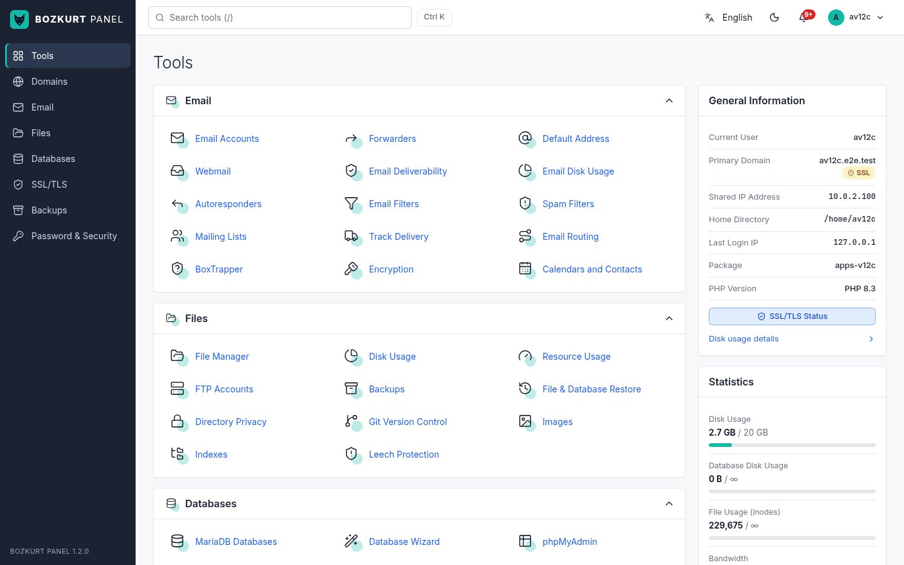

## Table of contents

[Ports](#ports-same-as-cpanelwhm) · [Install](#install) · [Upgrade](#upgrade) · [Uninstall](#uninstall) ·
[Features](#features-v120) · [Screenshots](#screenshots) · [Architecture](#architecture) ·
[Security](#security-model) · [Languages](#languages) · [Build from source](#build-from-source) ·
[Testing](#testing) · [Known limitations](#known-limitations) · [Contributing](#contributing) · [Licence](#licence)

## Ports (same as cPanel/WHM)

| Interface | HTTPS | HTTP (redirects to HTTPS) |
|---|---|---|
| User panel (cPanel equivalent) | **2083** | 2082 |
| Admin panel (WHM equivalent) | **2087** | 2086 |
| Webmail (Roundcube) | **2096** | 2095 |

All three sit at the root path (`https://server:2087/`). There is no `/yonetim` path and no port 8443.

## Install

On a **fresh** Ubuntu 24.04 or AlmaLinux 9 server, as root:

```bash
curl -fsSL https://get.bozkurtpanel.com | sudo bash
# non-interactive:
curl -fsSL https://get.bozkurtpanel.com | sudo bash -s -- \
  --hostname panel.example.com --email admin@example.com --profile full --lang en --yes
```

`install.sh` (in `installer/`) checks the OS and CPU, downloads
`bpanel-<version>-linux-<arch>.tar.gz` and its detached **minisign signature**,
verifies the signature against the release public key embedded in the script,
checks the binaries' SHA-256 sums and runs `bpanel-installer install`. The script
is served from `get.bozkurtpanel.com` (and the git repository) while the archives
come from GitHub Releases, so a compromised download host cannot slip in a
modified or older release: the signature's trusted comment names the file and the
version. `minisign` is used when installed, otherwise OpenSSL 3 (present on both
supported systems). A script without a release key refuses to install.

From an unpacked release archive you can run `sudo ./install.sh`; nothing is
downloaded, and `SHA256SUMS` is checked against `SHA256SUMS.minisig` first.
`BPANEL_ALLOW_UNSIGNED=1` runs an unsigned build you made yourself (development only).

The installer is staged and resumable (state in `/var/lib/bpanel/install-state.json`,
log in `/var/log/bpanel/install.log`). If a run stops, including in the middle of
package installation, run it again and it continues where it left off (an
interrupted dpkg run is completed first). On a fresh VM it waits for cloud-init
and unattended-upgrades to release the apt lock instead of failing.

> **v1.2.0 is not signed yet.** `get.bozkurtpanel.com` is not online and the release signing
> key has not been generated (`make release-keygen`), so the `curl | bash` one-liner above
> **fails closed** on purpose. Until signed releases exist you have two options:
>
> 1. **Use the v1.2.0 archive from GitHub Releases** (unsigned, SHA-256 checksums published):
>
>    ```bash
>    V=1.2.0; A=amd64   # or arm64
>    curl -fLO https://github.com/cumabozkurt/bpanel/releases/download/v$V/bpanel-$V-linux-$A.tar.gz
>    curl -fLO https://github.com/cumabozkurt/bpanel/releases/download/v$V/bpanel-$V-linux-$A.tar.gz.sha256
>    sha256sum -c bpanel-$V-linux-$A.tar.gz.sha256
>    tar -xzf bpanel-$V-linux-$A.tar.gz && cd bpanel-$V-linux-$A
>    sudo BPANEL_ALLOW_UNSIGNED=1 ./install.sh --hostname panel.example.com --email admin@example.com --profile full --yes
>    ```
>
> 2. **Build and sign it yourself**: `make release-keygen && make release` creates
>    `dist/bpanel-1.2.0-linux-amd64.tar.gz` signed with *your* key; copy it to the server,
>    unpack it and run `sudo ./install.sh`.
>
> `BPANEL_BASE_URL` points the script at another download location and `BPANEL_PUBKEY` at your
> own signing key. `BPANEL_ALLOW_UNSIGNED=1` only affects an unpacked local archive; the
> network install path always requires a valid signature.

Profiles: `minimal` (Nginx + PHP-FPM + MariaDB; every site is nginx-only, no Apache), `web` (+ Apache for `.htaccess`, PowerDNS, Pure-FTPd), `full` (+ Postfix/Dovecot mail, Rspamd, Roundcube webmail).
Flags: `--hostname --email --profile --lang en|tr --admin --php 8.2,8.4 --yes --force --allow-unsupported --skip-repos`.

What the installer changes on the system, besides installing packages:

- **Port 53 (web/full):** on Ubuntu, systemd-resolved's stub listener (127.0.0.53) is turned off
  (`/etc/systemd/resolved.conf.d/bpanel.conf`) so PowerDNS can answer on port 53, and
  `/etc/resolv.conf` points at resolved's upstream servers.
- **Firewall:** an nftables table `inet bpanel` (`bpanel-firewall.service`) replaces firewalld/ufw.
  SSH ports are read from `sshd -T` and, on Ubuntu 24.04, from `ssh.socket`.
- **fail2ban:** jails for SSH and the panel logins (and, with `full`, webmail, IMAP/POP3 and SMTP AUTH), banning through nftables.
- **SELinux (AlmaLinux):** file contexts for `/var/lib/bpanel`, `/usr/share/bpanel`, `/etc/bpanel/ssl`,
  `~/public_html`, `~/tmp`, `~/mail`, the needed `httpd_*`/`ftpd_full_access` booleans and ports 2090/2095/2096/8080.
- **Mail (full):** mail for `root` goes to `--email` (`/etc/aliases`).
- **Directories:** `/var/lib/bpanel` is `root:bpanel 0751`; the panel database lives in
  `/var/lib/bpanel/db` (API user only), ACME challenges in `/var/lib/bpanel/acme`
  (world-readable), webmail/phpMyAdmin state in `/var/lib/bpanel/apps` (`bpanel-apps`).
- **Logs:** `/etc/logrotate.d/bpanel` rotates domain logs daily (14 days) and the install log.
- Each PHP-FPM service gets a private `/tmp`; accounts use `~/tmp` through their pool.

`sudo bpanel-installer render --profile full --out /tmp/cfg` writes every generated
configuration file for review; `make validate-configs` checks them with `nginx -t`,
`apache2ctl configtest`, `php-fpm -t`, `postfix check`, `sshd -t`, fail2ban and
`systemd-analyze` on a scratch machine.

At the end the installer prints the panel URLs and a one-time admin login link (`bpanel login-link` makes a new one).

## Upgrade

```bash
curl -fsSL https://get.bozkurtpanel.com | sudo bash -s -- upgrade   # or, on the server:
sudo bpanel-installer upgrade
```

Running the installer on a server with an older version upgrades it automatically.
The upgrade installs packages a newer release needs, re-applies the system hardening
and service configuration of the new release, replaces the binaries and units,
migrates the panel database and files (for example the restic binary moved to
`/usr/local/lib/bpanel/bin/restic`), restarts the panel and runs the self-test.
Websites, mail and data stay online. It can be interrupted and run again; on an
up-to-date server it re-applies the configuration (`--force` repeats every step).
The installer keeps a copy of itself in `/usr/local/lib/bpanel`
(`/usr/local/sbin/bpanel-installer`), so neither upgrade nor uninstall needs the
original archive.

## Uninstall

```bash
sudo bpanel-installer uninstall          # remove the panel; sites, mail, DNS and DBs keep running
sudo bpanel-installer uninstall --purge  # also delete the panel database, configuration and secrets
```

The uninstaller removes the panel itself (`bpanel-api`, `bpanel-agent`, the binaries,
phpMyAdmin and the panel's fail2ban jail) and leaves the server **working**:

- nginx, Apache, PHP-FPM, PowerDNS, Postfix, Dovecot, Rspamd and Pure-FTPd keep the
  configuration the panel gave them. Stock files are not copied back over it (Apache's
  stock `ports.conf` would take port 80 from nginx, the stock `pdns.conf` would drop the
  zone database); the originals stay next to them as `*.bpanel-orig`.
- **Firewall:** firewalld or ufw, if one was active before the install, is turned back on
  with the site ports opened. Otherwise `bpanel-firewall.service` stays active without the
  panel ports. The server is never left without a firewall.
- systemd-resolved's stub listener stays off while PowerDNS is installed (both cannot own port 53);
  otherwise `/etc/resolv.conf` is restored.
- The SFTP jail (`/etc/ssh/sshd_config.d/50-bpanel.conf`) stays while hosting accounts exist.
- SELinux contexts and booleans stay (the sites still need them); the uninstaller prints the values from before the install.

`--purge` also deletes `/etc/bpanel/{api.json,agent.json,secrets,acme,restic,accounts,owners}`,
the panel database, the download cache and restic. Without `--purge`, restic and the backup
repository passwords stay so the backups in `/var/backups/bpanel` can still be restored. It keeps what running services still use and says so:
`/etc/bpanel/ssl` (the certificate of nginx, Postfix, Dovecot and Pure-FTPd),
`/var/lib/bpanel/acme` and the Roundcube webmail. Distribution packages are never
removed; use apt/dnf if you want them gone.

## Features (v1.2.0)

Full table with status and E2E evidence per feature: [`docs/feature-matrix.md`](docs/feature-matrix.md).
**100 %** of the cPanel/WHM feature list (97 rows) is implemented and **100 %** passed the container
end-to-end run (520 / 521 checks passed, 1 skipped for an environment reason, 0 failed).
Docs index: [`docs/index.md`](docs/index.md).

- **Email:** accounts, forwarders, catch-all, Roundcube webmail, SPF/DKIM/DMARC, autoresponders, Sieve filters, Rspamd spam filters, delivery tracking, mailing lists (mlmmj), **Email Routing, BoxTrapper, Email Encryption (GnuPG), Calendars & Contacts (CalDAV/CardDAV, Radicale)**.
- **Files & web:** file manager, disk usage, FTP/SFTP, **SSH key manager**, restic backups and restore, directory privacy, hotlink protection, **leech protection, indexes, Apache handlers**, error pages, MIME types, IP blocker, **Images, Site Publisher**, Git version control, **Visitors** statistics.
- **Databases:** MariaDB + wizard, phpMyAdmin SSO, remote MySQL, PostgreSQL + **built-in PostgreSQL browser** (phpPgAdmin replacement), process list.
- **Domains & DNS:** addon/sub/alias domains, redirects, PowerDNS zone editor, DNSSEC, zone import/export and history, Dynamic DNS, DNS cluster, **Cloudflare sync**.
- **Software:** MultiPHP + INI editor, App Installer with **16 free apps** (WordPress, Joomla, Drupal, Nextcloud, Matomo, phpBB, MediaWiki, DokuWiki, Grav, Backdrop CMS, WonderCMS, MyBB, OpenCart, Mautic, Omeka S, FOSSBilling), WordPress Toolkit, Node.js/Python/**Ruby** Application Manager, cron, browser terminal, Track DNS.
- **WHM:** accounts, packages, resellers with privileges, modify account, services, update preferences, SQL settings, bandwidth, Transfer Tool (cPanel `cpmove` import), backup configuration, plugins, API tokens, OpenAPI, **Mail Queue Manager, Mail Troubleshooter, IP Functions, Change Hostname, Tweak Settings, PHP extensions (EasyApache equivalent), billing events + WHMCS module**.
- **Beyond cPanel:** BPanel Shield (ClamAV/YARA/heuristics, quarantine), nftables firewall with rollback, fail2ban/CrowdSec, ModSecurity + OWASP CRS, per-account cgroup v2 isolation and bwrap cage, multi-server over mTLS, monitoring/alerts/FIM with Prometheus metrics, RBAC, security events and webhooks, encrypted secrets.

## Screenshots

All captures come from the **v1.2.0 build** running on the Ubuntu 24.04 E2E server
([`docs/screenshots/v12/`](docs/screenshots/v12/), English and Turkish) plus the v1.1 feature pages
([`docs/screenshots/v11/`](docs/screenshots/v11/)). Older v0.x/v1.0 captures were removed.

| | |
|---|---|
|  | 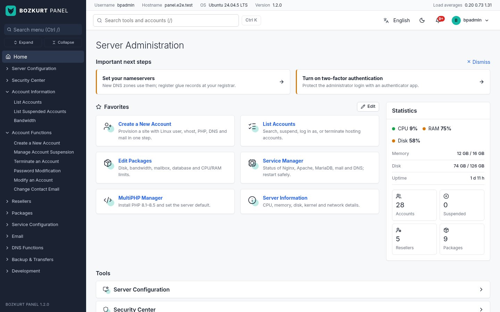 |
| cPanel-style user tools (port 2083) | WHM-style admin dashboard (port 2087) |
| 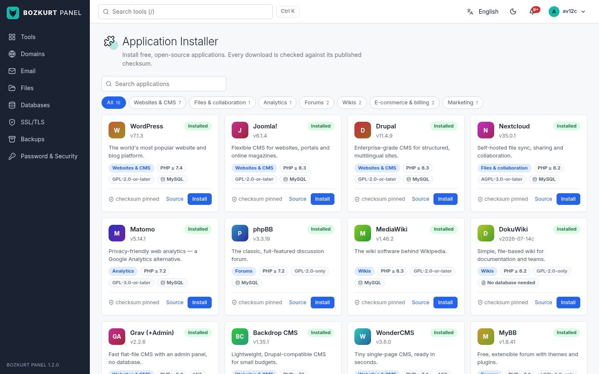 | 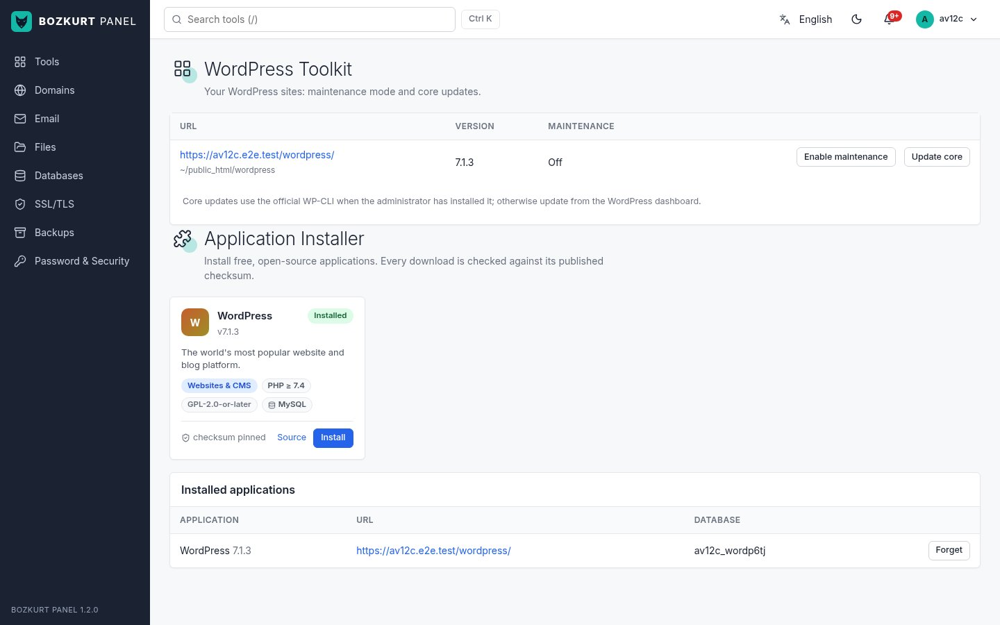 |
| App Installer — 16 free, checksum-pinned apps | WordPress Toolkit |
| 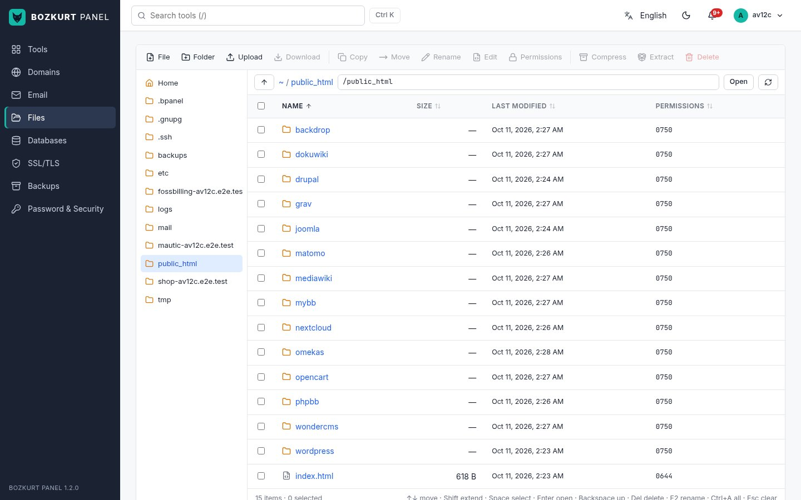 | 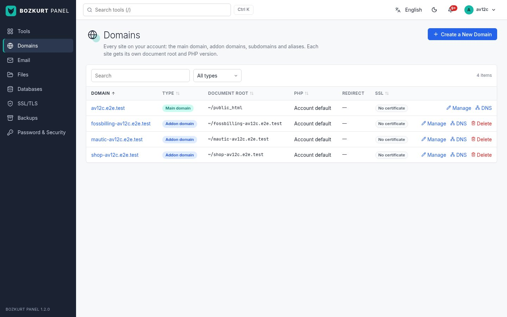 |
| File Manager | Domains |
| 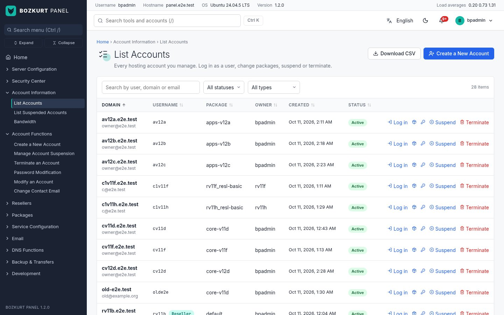 | 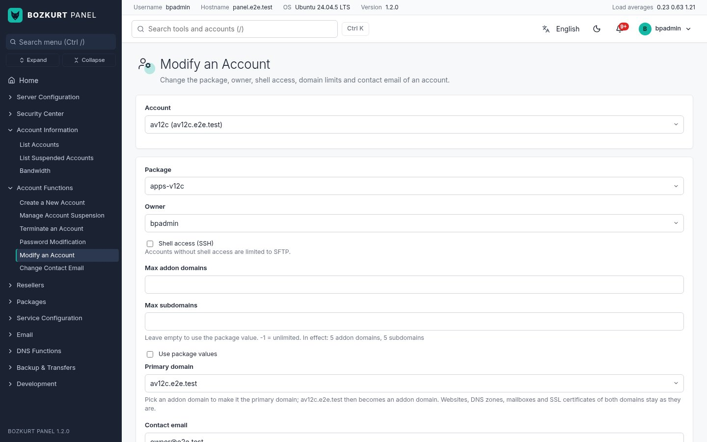 |
| List Accounts | Modify Account / Change Primary Domain |
| 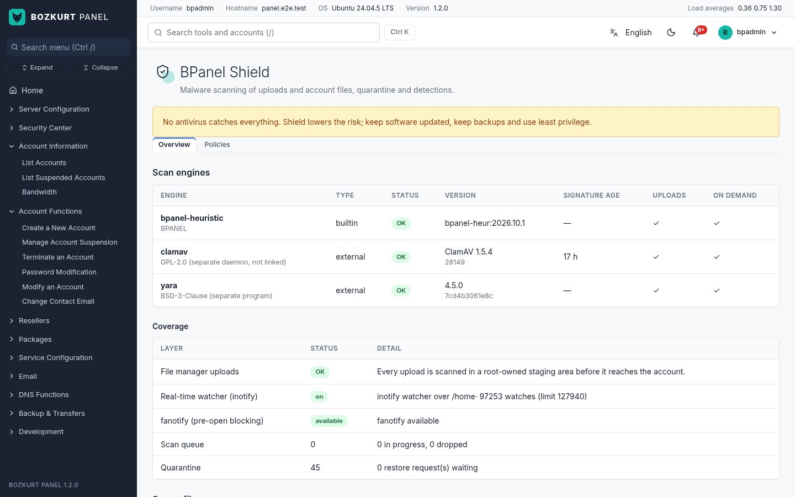 | 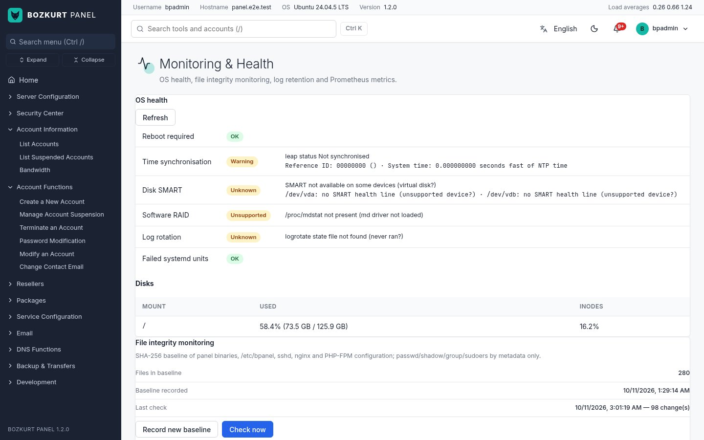 |
| BPanel Shield (ClamAV, YARA, heuristics) | Monitoring & health |
| 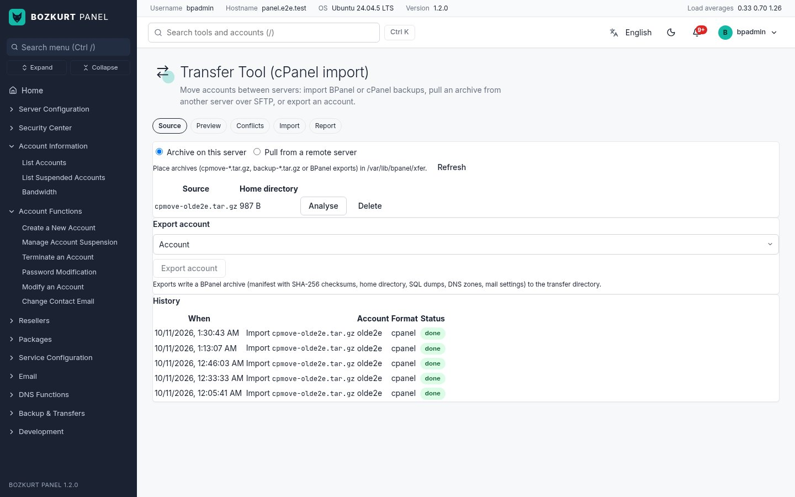 | 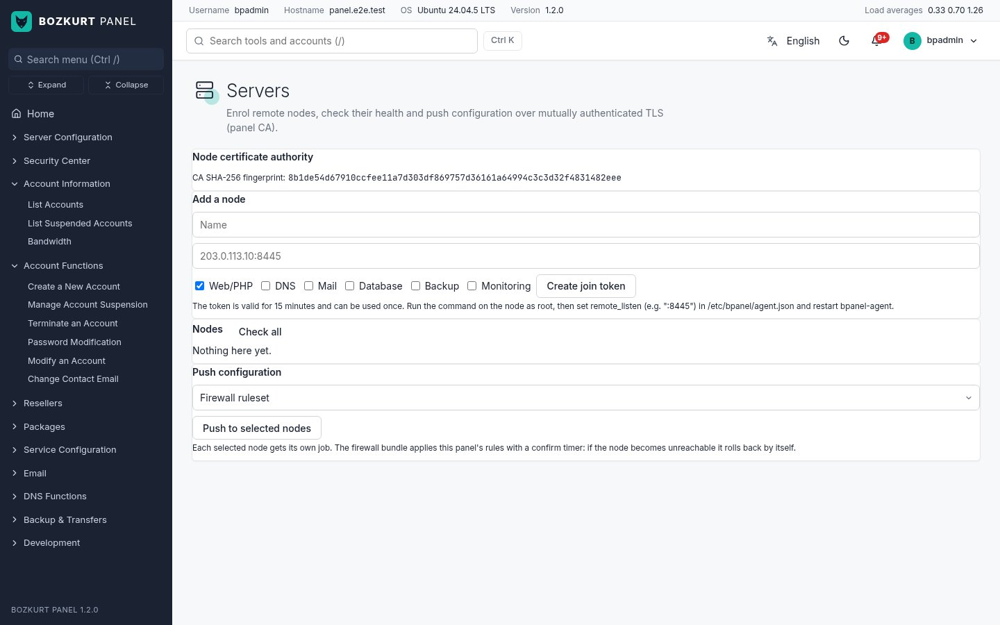 |
| Transfer Tool (cPanel `cpmove` import) | Multi-server nodes (mTLS) |
| 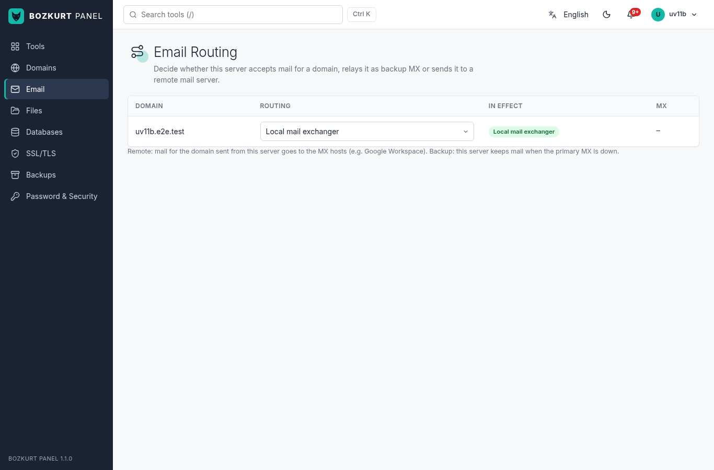 | 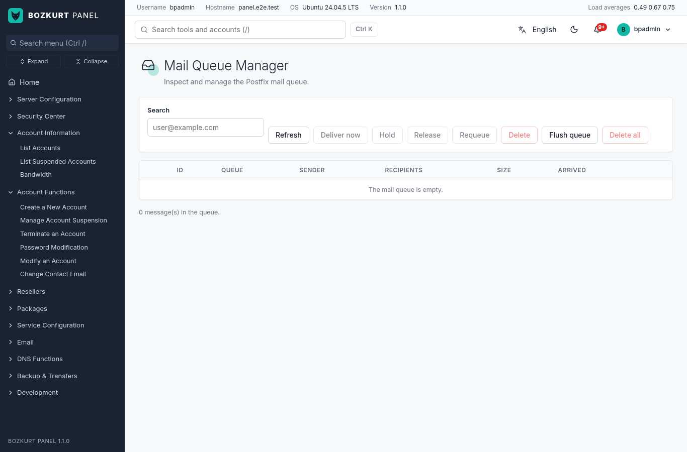 |
| Email Routing | Mail Queue Manager |

## Architecture

| Part | What it does |
|---|---|
| `bpanel-api` (`cmd/bpanel-api`) | Go HTTP API + embedded SvelteKit SPA. Runs as the unprivileged `bpanel` user under systemd hardening and serves 2083/2082 and 2087/2086. SQLite state. |
| `bpanel-agent` (`cmd/bpanel-agent`) | Root helper on a unix socket (`/run/bpanel/agent.sock`), accepting only the API's uid (SO_PEERCRED). It runs a **fixed set of typed actions** (`account.create`, `web.vhost.apply`, `dns.rrset.replace`, …). Parameters are strictly decoded JSON (unknown fields rejected) and validated. External programs run as argv, **never through a shell**, and there is no "run command" action. |
| `bpanel` (`cmd/bpanel`) | Admin CLI: `version`, `login-link`, `admin`, `selftest`, `openapi`. |
| `bpanel-installer` | Staged installer / uninstaller. |
| `web/` | SvelteKit (Svelte 5) SPA, built into `internal/webui/dist` and embedded in `bpanel-api`. |

Stack it configures: Nginx (+ optional Apache behind it for `.htaccess`), PHP-FPM
(one pool per user, MultiPHP 8.1–8.5), MariaDB, PowerDNS, Postfix + Dovecot + Rspamd,
Roundcube, phpMyAdmin, Pure-FTPd, Let's Encrypt via lego, restic backups and nftables.

API reference: `docs/openapi.json` (OpenAPI 3.1), also served by the panel at `/openapi.json`.

## Security model

Summarised from [`docs/security.md`](docs/security.md), [`docs/isolation.md`](docs/isolation.md) and
[`docs/architecture.md`](docs/architecture.md); report vulnerabilities privately as described in
[`SECURITY.md`](SECURITY.md).

- **Privilege split:** the web-facing API runs as the unprivileged `bpanel` user under systemd hardening;
  only the root agent changes the system, over a unix socket restricted to the API's uid (SO_PEERCRED).
- **No shell, no "run command":** the agent exposes a fixed list of typed actions; parameters are
  strictly decoded, validated again by the agent and passed as argv. Paths go through `safefs`
  (canonical, under allowed roots, no symlink following).
- **Tenant gate:** every tenant action requires a panel-managed account, and the agent's ownership
  registry refuses cross-account actions on vhosts, zones and mail domains.
- **Accounts and sessions:** argon2id password hashing (OWASP baseline parameters), login rate limiting, TOTP 2FA with recovery codes,
  step-up re-authentication for sensitive actions, CSRF protection, fine-grained RBAC on every admin
  route, scoped API tokens, audit log and security events with HMAC-signed webhooks.
- **Secrets at rest:** AES-256-GCM envelope encryption (optional OpenBao provider); logs pass through a
  redaction handler.
- **Network:** nftables table `inet bpanel` with lockout guard and confirm-or-rollback, fail2ban
  (optional CrowdSec), per-domain ModSecurity + OWASP CRS, per-account cgroup v2 limits and a bubblewrap
  cage for shell, cron and the browser terminal.
- **Supply chain:** releases are designed to be minisign-signed, and `install.sh` fails closed without a
  release key; App Installer packages are version- and checksum-pinned.

## Languages

English is the default and Turkish is fully translated (3068 keys each in v1.2.0,
checked by `make i18n`). Every page has a language switcher. Each user's choice is stored
on their account (`PUT /api/v1/account/preferences`). Administrators set the
server default in **Settings**. To add a language, copy
`web/src/lib/i18n/locales/en.json` to `xx.json`, translate it and rebuild.

## Build from source

Needs Go 1.27+ (`go.mod` pins 1.27.2; with `GOTOOLCHAIN=auto` an older `go` downloads it), Node 20+ and pnpm 10.

```bash
git clone https://github.com/cumabozkurt/bpanel.git && cd bpanel
```

The built web UI is committed in `internal/webui/dist`, so `go build ./...` works on a fresh clone;
run `make web embed` after changing anything under `web/`.

```bash
make web embed     # build the SPA and copy it into internal/webui/dist
make vet test      # go vet + go test
make build         # host binaries in bin/
make release       # static linux-amd64 + linux-arm64 tarballs, SHA-256 sums and minisign signatures in dist/
make release-keygen   # one-time: create the release signing key, embed its public half in install.sh
make test-installer   # installer tests + install.sh signature tests
make validate-configs # generated configs through nginx -t, apache2ctl, php-fpm -t, postfix check, sshd -t (root, scratch box)
make dev           # run the API with the in-process mock agent on :2083 / :2087 (no root)
make openapi       # regenerate docs/openapi.json
```

Dev mode logins: admin `bpadmin` / `Demo-Pass-2026` (port 2087), user `demo` / `Demo-User-2026` (port 2083).

`packaging/` holds copies of the files the installer writes: systemd units
(`bpanel-api.service`, `bpanel-agent.service`, `bpanel-firewall.service`, PHP-FPM and
resolved drop-ins), logrotate, fail2ban, Apache base config, the SSH SFTP jail and tmpfiles.
A test keeps them identical to what the installer generates. The nginx base config is
generated per server (it only adds directives the distribution file does not set);
see `bpanel-installer render`.

## Testing

```bash
make vet test                     # go vet + go test ./...
go test -race ./...               # race detector (needs cgo / a C compiler)
make test-installer               # installer tests + install.sh signature tests (needs minisign + openssl)
make i18n                         # EN/TR key parity, tool and error-code coverage
cd web && pnpm install && pnpm run build
go test ./internal/xfer -run '^$' -fuzz FuzzCleanName -fuzztime 30s   # any of the 16 fuzz targets
```

End-to-end suites (run inside a disposable server as root): [`test/e2e/`](test/e2e/). Results:
[`docs/evidence/e2e-v1/SUMMARY.md`](docs/evidence/e2e-v1/SUMMARY.md) (v1.1.0: 521 checks, 520 passed,
0 failed; v1.2.0 re-run: core 129 / 129 passed, apps 81 / 81 passed, UI 176 / 176). Release notes:
[`docs/release-notes/v1.2.0.md`](docs/release-notes/v1.2.0.md). CI runs vet,
tests, the i18n check, the web build and the install.sh signature tests on every push.

## Known limitations

- **No run on a real VPS or on AlmaLinux 9 yet.** v1.2.0 was verified end to end in an Ubuntu 24.04
  container with systemd as PID 1 and the real services (Postfix, Dovecot, Rspamd, PowerDNS, MariaDB,
  PostgreSQL, nginx + Apache, ModSecurity + CRS, ClamAV, YARA, nftables, fail2ban, …). Still to do:
  a real VPS (public DNS, Let's Encrypt production, real port 25), AlmaLinux 9 with SELinux
  enforcing, SFTP/S3 backup targets, the real Cloudflare API (tested against a local mock) and
  multi-server across two hosts.
- **v1.2.0 archives are unsigned; `curl | bash` install is blocked until a release key exists.** `install.sh` fails closed
  while `BPANEL_RELEASE_PUBKEY` is `UNSET`. The maintainer must run `make release-keygen`
  (offline) and publish signed releases with `make release`.
- **Feature parity (v1.2.0):** 97 / 97 cPanel/WHM rows implemented and verified in the container
  (`docs/feature-matrix.md`). Some rows are free replacements rather than the same product (Rspamd for
  SpamAssassin, mlmmj for Mailman, the built-in PostgreSQL browser for phpPgAdmin, BPanel Shield for
  Imunify360, cgroup v2 + bubblewrap for CloudLinux); the notes column says so.
- **`/home` is set to `root:root 0711`** at install so tenants cannot list other homes (the
  SFTP chroot is `ChrootDirectory /home`). Uninstall does not change it back.
- **Agent ownership registry limit:** the root agent records which account owns each vhost,
  zone and mail domain and refuses cross-account actions, but a fully compromised API can
  still name the right owner for a victim's domain (the API is the identity provider).
- **Deferred code items:** CODE-21 (changing the server IP, nameservers or default PHP does not
  re-render existing zones/vhosts; the admin gets a warning), CODE-23 (no pagination on
  user-side lists), CODE-25 (inode limit unused), CODE-26 (`users.owner_id` has no `ON DELETE` rule; single SQLite connection).
- PHP-FPM pools share one `bpanel-php.slice`; true per-tenant FPM cgroups would need one FPM
  master per account. Cron jobs reach `user-<uid>.slice` through `pam_systemd`.
- After a hostname certificate renewal, Postfix/Dovecot/Pure-FTPd are not reloaded
  automatically yet.

## Contributing

Issues and pull requests are welcome; see [`CONTRIBUTING.md`](CONTRIBUTING.md). Please report
security problems privately ([`SECURITY.md`](SECURITY.md)), not in public issues.

## Licence

Apache License 2.0. See [LICENSE](LICENSE) and [NOTICE](NOTICE); third-party components and their
licences are listed in [`docs/third-party-licenses.md`](docs/third-party-licenses.md).

---

## Türkçe

**BOZKURT PANEL (BPANEL)**, cPanel/WHM düzenini ve portlarını kullanan, açık kaynaklı
(Apache-2.0) bir web hosting kontrol panelidir. **Ubuntu 24.04 LTS** ve **AlmaLinux 9** içindir.

> **Durum: v1.2.0 — cPanel/WHM özellik listesinin tamamı, 16 tek tıkla uygulama, hiçbir yerde "yakında" yok.**
> v1.2.0 ile Uygulama Yükleyici 4'ten **16 ücretsiz uygulamaya** çıktı (sağlama toplamı sabitlenmiş; her biri
> E2E konteynerinde kuruldu ve sunuldu), **Birincil Alan Adını Değiştir** eklendi, tüm "yakında" yüzeyleri
> kaldırıldı ve arayüz cilalandı. Son 1.2.0 derlemesinde yeniden çalıştırma: çekirdek paket **129 / 129 geçti**,
> uygulama paketi **81 / 81 geçti**, arayüz testi **176 / 176** sayfa yüklemesi (TR + EN, kullanıcı + yönetici) hatasız.
>
> [`docs/feature-matrix.md`](docs/feature-matrix.md) içindeki **97 / 97** cPanel/WHM özellik satırının
> tamamı uygulanmıştır (**%100**; "planlanmadı" ya da "kısmi" satır kalmadı) ve **her satır**, systemd'nin
> PID 1 olduğu ve gerçek servislerin çalıştığı bir Ubuntu 24.04 konteynerinde **uçtan uca testten
> geçmiştir**: **520 denetim geçti, 0 başarısız, 1 atlandı** ([E2E kanıtı](docs/evidence/e2e-v1/SUMMARY.md)).
> Proje sitesi: <https://cumabozkurt.github.io/bpanel/>. **Tamamen ücretsiz yazılım**: ücretli bileşen,
> lisans veya API yok. Birim, race, fuzz ve güvenlik regresyon testleri geçiyor. **Henüz yapılmayanlar:**
> gerçek bir VPS ve AlmaLinux 9 üzerinde çalıştırma ile imzalı arşivler (v1.2.0 imzasızdır; SHA-256
> değerini doğrulayın). Önce silinebilir bir sunucuda deneyin. Bkz. [Bilinen sınırlamalar](#bilinen-sınırlamalar).

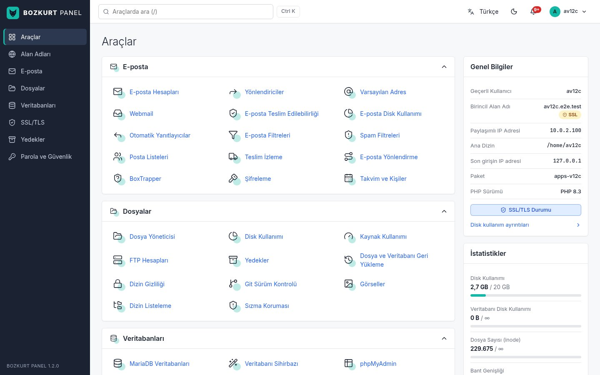

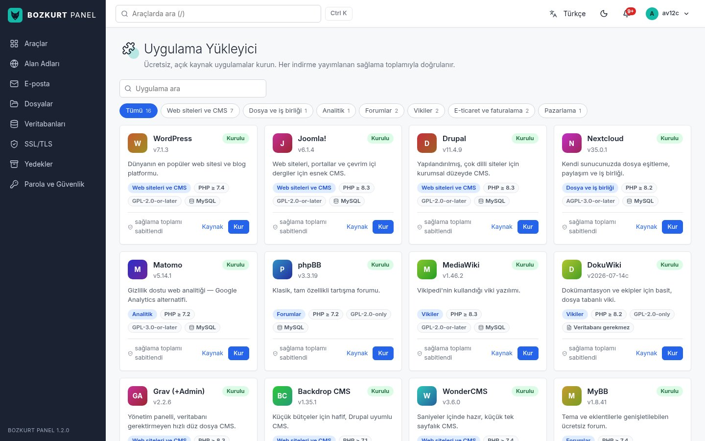

### Portlar (cPanel/WHM ile aynı)

| Arayüz | HTTPS | HTTP (HTTPS'e yönlendirir) |
|---|---|---|
| Kullanıcı paneli (cPanel karşılığı) | **2083** | 2082 |
| Yönetici paneli (WHM karşılığı) | **2087** | 2086 |
| Web posta (Roundcube) | **2096** | 2095 |

Üçü de kök yolda açılır (`https://sunucu:2087/`). `/yonetim` yolu ve 8443 portu yoktur.

### Kurulum

**Temiz** bir Ubuntu 24.04 veya AlmaLinux 9 sunucuda, root olarak:

```bash
curl -fsSL https://get.bozkurtpanel.com | sudo bash
# etkileşimsiz:
curl -fsSL https://get.bozkurtpanel.com | sudo bash -s -- \
  --hostname panel.ornek.com.tr --email admin@ornek.com.tr --profile full --lang tr --yes
```

`install.sh` işletim sistemini ve mimariyi denetler, sürüm arşivini ve ayrık
**minisign imzasını** indirir, imzayı betiğin içine gömülü sürüm açık anahtarıyla
doğrular, ikili dosyaların SHA-256 sağlamalarını denetler ve `bpanel-installer install`
komutunu çalıştırır. Betik `get.bozkurtpanel.com` adresinden, arşivler GitHub
Releases'tan gelir: indirme sunucusu ele geçirilse bile değiştirilmiş ya da eski bir
sürüm kabul edilmez. Anahtarı olmayan bir betik kurulum yapmaz. Kurulum aşamalıdır;
yarıda kalırsa (paket kurulumunun ortası dahil) komutu yeniden çalıştırın, kaldığı yerden
devam eder. Yeni bir sunucuda apt kilidinin açılmasını bekler.

> **v1.2.0 henüz imzalı değil.** `get.bozkurtpanel.com` yayında değil ve sürüm imzalama
> anahtarı üretilmedi (`make release-keygen`); bu yüzden yukarıdaki `curl | bash` komutu
> bilerek kurulumu reddeder. İmzalı sürümler çıkana kadar:
>
> 1. **GitHub Releases'taki v1.2.0 arşivini kullanın** (imzasız, SHA-256 sağlamaları yayında):
>
>    ```bash
>    V=1.2.0; A=amd64   # ya da arm64
>    curl -fLO https://github.com/cumabozkurt/bpanel/releases/download/v$V/bpanel-$V-linux-$A.tar.gz
>    curl -fLO https://github.com/cumabozkurt/bpanel/releases/download/v$V/bpanel-$V-linux-$A.tar.gz.sha256
>    sha256sum -c bpanel-$V-linux-$A.tar.gz.sha256
>    tar -xzf bpanel-$V-linux-$A.tar.gz && cd bpanel-$V-linux-$A
>    sudo BPANEL_ALLOW_UNSIGNED=1 ./install.sh --hostname panel.ornek.com.tr --email admin@ornek.com.tr --profile full --lang tr --yes
>    ```
>
> 2. **Kendiniz derleyip imzalayın:** `make release-keygen && make release`, kendi anahtarınızla
>    imzalı `dist/bpanel-1.2.0-linux-amd64.tar.gz` üretir; sunucuya kopyalayıp açın ve
>    `sudo ./install.sh` çalıştırın.

Profiller: `minimal` (Nginx + PHP-FPM + MariaDB; Apache yok, siteler yalnızca Nginx ile), `web` (+ `.htaccess` için Apache, PowerDNS, Pure-FTPd), `full` (+ Postfix/Dovecot e-posta, Rspamd, Roundcube web posta).

Kurucu ayrıca: PowerDNS için systemd-resolved'ın 127.0.0.53 dinleyicisini kapatır,
firewalld/ufw yerine nftables tablosu kurar, SSH ve panel girişleri için fail2ban
kuralları ekler, AlmaLinux'ta SELinux etiketlerini ve booleanlarını ayarlar, `root`
postasını `--email` adresine yönlendirir ve günlük döndürmeyi (logrotate) yapılandırır.

### Yükseltme

```bash
curl -fsSL https://get.bozkurtpanel.com | sudo bash -s -- upgrade   # ya da sunucuda:
sudo bpanel-installer upgrade
```

Eski bir sürümün kurulu olduğu sunucuda kurucu otomatik olarak yükseltme yapar: yeni
sürümün gerektirdiği paketleri kurar, sıkılaştırmayı ve servis ayarlarını yeniden
uygular, ikili dosyaları ve servis birimlerini değiştirir, veritabanını ve dosyaları
taşır, paneli yeniden başlatır ve kendi kendine testi çalıştırır. Siteler, e-posta ve
veriler çalışmaya devam eder; yarıda kalırsa yeniden çalıştırılabilir. Kurucunun bir
kopyası `/usr/local/lib/bpanel` içinde kalır.

### Kaldırma

```bash
sudo bpanel-installer uninstall          # paneli kaldırır; siteler, e-posta, DNS ve veritabanları çalışmaya devam eder
sudo bpanel-installer uninstall --purge  # panel veritabanını, ayarlarını ve gizli anahtarlarını da siler
```

Kaldırıcı yalnızca paneli (servisler, ikili dosyalar, phpMyAdmin, panelin fail2ban
kuralı) siler ve sunucuyu **çalışır durumda** bırakır: Nginx, Apache, PHP-FPM, PowerDNS
ve posta servisleri panelin verdiği ayarlarla çalışmaya devam eder (özgün dosyalar
`*.bpanel-orig` olarak yanlarında durur). Kurulumdan önce firewalld veya ufw açıksa
site portları açılarak geri getirilir; değilse `bpanel-firewall` panel portları
olmadan çalışmaya devam eder, sunucu hiçbir zaman güvenlik duvarsız kalmaz. PowerDNS
kuruluysa systemd-resolved dinleyicisi kapalı kalır. `--purge`, servislerin hâlâ
kullandığı dosyaları (`/etc/bpanel/ssl`, `/var/lib/bpanel/acme`, web posta) silmez ve
bunları listeler. Dağıtım paketleri hiçbir zaman silinmez.

### Özellikler (v1.2.0)

Özellik başına durum ve E2E kanıtı: [`docs/feature-matrix.md`](docs/feature-matrix.md). cPanel/WHM
özellik listesinin **%100**'ü (97 satır) uygulanmış ve **%100**'ü konteynerde uçtan uca testten geçmiştir
(521 denetimden 520'si geçti, 1'i ortam nedeniyle atlandı, 0 başarısız).

- **E-posta:** hesaplar, yönlendiriciler, catch-all, Roundcube web posta, SPF/DKIM/DMARC, otomatik yanıtlayıcılar, Sieve filtreleri, Rspamd spam filtreleri, teslimat takibi, e-posta listeleri (mlmmj), **E-posta Yönlendirme (routing), BoxTrapper, E-posta Şifreleme (GnuPG), Takvimler ve Kişiler (CalDAV/CardDAV, Radicale)**.
- **Dosyalar ve web:** dosya yöneticisi, disk kullanımı, FTP/SFTP, **SSH anahtar yöneticisi**, restic yedekleme ve geri yükleme, dizin gizliliği, hotlink koruması, **sızma (leech) koruması, dizin listeleme, Apache işleyicileri**, hata sayfaları, MIME türleri, IP engelleyici, **Görseller, Site Yayıncısı**, Git sürüm kontrolü, **Ziyaretçi** istatistikleri.
- **Veritabanları:** MariaDB + sihirbaz, phpMyAdmin tek oturum, uzak MySQL, PostgreSQL + **yerleşik PostgreSQL tarayıcısı**, işlem listesi.
- **Alan adları ve DNS:** eklenti/alt/takma alan adları, yönlendirmeler, PowerDNS bölge düzenleyici, DNSSEC, bölge içe/dışa aktarma ve geçmiş, Dinamik DNS, DNS kümesi, **Cloudflare eşitleme**.
- **Yazılım:** MultiPHP + INI düzenleyici, **16 ücretsiz uygulamalı** Uygulama Yükleyici (WordPress, Joomla, Drupal, Nextcloud, Matomo, phpBB, MediaWiki, DokuWiki, Grav, Backdrop CMS, WonderCMS, MyBB, OpenCart, Mautic, Omeka S, FOSSBilling), WordPress Araç Seti, Node.js/Python/**Ruby** uygulama yöneticisi, cron, tarayıcıda terminal, DNS izleme.
- **WHM:** hesaplar, paketler, yetkili bayiler, hesap düzenleme, servisler, güncelleme tercihleri, SQL ayarları, bant genişliği, Taşıma Aracı (cPanel `cpmove`), yedek yapılandırması, eklentiler, API anahtarları, OpenAPI, **Posta Kuyruğu Yöneticisi, Posta Sorun Giderici, IP İşlemleri, Sunucu Adı Değiştirme, İnce Ayarlar, PHP eklentileri (EasyApache karşılığı), faturalama olayları + WHMCS modülü**.
- **cPanel'in ötesinde:** BPanel Shield (ClamAV/YARA/sezgisel, karantina), geri almalı nftables güvenlik duvarı, fail2ban/CrowdSec, ModSecurity + OWASP CRS, hesap başına cgroup v2 izolasyonu ve bwrap kafesi, mTLS ile çoklu sunucu, Prometheus metrikli izleme/uyarı/dosya bütünlüğü, RBAC, güvenlik olayları ve webhook'lar, şifreli gizli anahtarlar.

### Mimari ve güvenlik

`bpanel-api`, yetkisiz `bpanel` kullanıcısıyla çalışır. Root yetkisi gereken her iş
unix soketi üzerinden `bpanel-agent`'a gider. Ajan yalnızca **tanımlı, tipli
eylemleri** çalıştırır: parametreler katı biçimde çözülür ve doğrulanır, programlar argv ile
çağrılır, **hiçbir zaman kabuk (shell) kullanılmaz** ve "komut çalıştır" diye bir eylem yoktur.

### Diller

Varsayılan dil İngilizcedir, Türkçe çevirisi tamdır (v1.2.0'da her dilde 3068 anahtar). Her sayfada dil seçici vardır.
Her kullanıcının seçimi kendi hesabında saklanır. Sunucu varsayılanını yönetici
**Ayarlar** sayfasından belirler.

### Kaynaktan derleme

Go 1.27+, Node 20+ ve pnpm gerekir: `git clone https://github.com/cumabozkurt/bpanel.git`, ardından
`make web embed vet test release`. Derlenmiş web arayüzü `internal/webui/dist` içinde depoya dahildir;
temiz bir klonda `go build ./...` doğrudan çalışır. Sahte ajanla
geliştirme sunucusu için `make dev` kullanın (yönetici `bpadmin` / `Demo-Pass-2026`, kullanıcı
`demo` / `Demo-User-2026`).

### Bilinen sınırlamalar

- **Henüz gerçek bir VPS'te ve AlmaLinux 9'da çalıştırılmadı.** v1.2.0, systemd'nin PID 1 olduğu ve
  gerçek servislerin (Postfix, Dovecot, Rspamd, PowerDNS, MariaDB, PostgreSQL, nginx + Apache,
  ModSecurity + CRS, ClamAV, YARA, nftables, fail2ban, …) çalıştığı bir Ubuntu 24.04 konteynerinde
  uçtan uca doğrulandı. Kalanlar: gerçek VPS (genel DNS, Let's Encrypt üretim ortamı, gerçek 25. port),
  SELinux zorunlu kipte AlmaLinux 9, SFTP/S3 yedek hedefleri, gerçek Cloudflare API'si (yerel sahte
  sunucuyla test edildi) ve iki sunuculu çoklu sunucu kurulumu.
- **v1.2.0 arşivleri imzasız; sürüm anahtarı üretilene kadar `curl | bash` kurulumu kapalı.** `BPANEL_RELEASE_PUBKEY`
  `UNSET` iken `install.sh` kurulumu reddeder. Bakımcının `make release-keygen` (çevrimdışı)
  çalıştırıp imzalı sürümleri `make release` ile yayınlaması gerekir.
- **Özellik kapsamı (v1.2.0):** 97 / 97 cPanel/WHM satırı uygulanmış ve konteynerde doğrulanmıştır
  (`docs/feature-matrix.md`). Bazı satırlar aynı ürün değil, ücretsiz karşılığıdır (SpamAssassin yerine
  Rspamd, Mailman yerine mlmmj, phpPgAdmin yerine yerleşik PostgreSQL tarayıcısı, Imunify360 yerine
  BPanel Shield, CloudLinux yerine cgroup v2 + bubblewrap); notlar sütununda belirtilir.
- **`/home` kurulumda `root:root 0711` yapılır**; böylece hesaplar birbirlerinin dizinlerini
  listeleyemez (SFTP chroot `ChrootDirectory /home`). Kaldırma işlemi bunu geri almaz.
- **Ajan sahiplik kaydı sınırı:** root ajan her vhost, DNS bölgesi ve e-posta alan adının hangi
  hesaba ait olduğunu kaydeder ve hesaplar arası işlemleri reddeder; ancak tamamen ele
  geçirilmiş bir API, kurbanın alan adı için doğru sahibi yine de bildirebilir (kimliği API belirler).
- **Ertelenen kod maddeleri:** CODE-21 (sunucu IP'si, ad sunucuları veya varsayılan PHP
  değişince mevcut bölgeler/vhost'lar yeniden üretilmez; yöneticiye uyarı gösterilir), CODE-23
  (kullanıcı tarafı listelerde sayfalama yok), CODE-25 (inode sınırı kullanılmıyor), CODE-26 (`users.owner_id` için
  `ON DELETE` kuralı yok; tek SQLite bağlantısı).
- PHP-FPM havuzları ortak bir `bpanel-php.slice` içinde çalışır; hesap başına gerçek cgroup
  için hesap başına ayrı FPM ana süreci gerekir. Cron işleri `pam_systemd` ile
  `user-<uid>.slice` içine düşer.
- Ana makine sertifikası yenilendiğinde Postfix/Dovecot/Pure-FTPd henüz otomatik yeniden yüklenmiyor.

### Katkı

Hata kayıtları ve çekme istekleri memnuniyetle karşılanır; bkz. [`CONTRIBUTING.md`](CONTRIBUTING.md).
Güvenlik açıklarını herkese açık kayıt yerine [`SECURITY.md`](SECURITY.md) içindeki yolla bildirin.

### Lisans

Apache Lisansı 2.0. Ayrıntılar için [LICENSE](LICENSE) dosyasına bakın.
